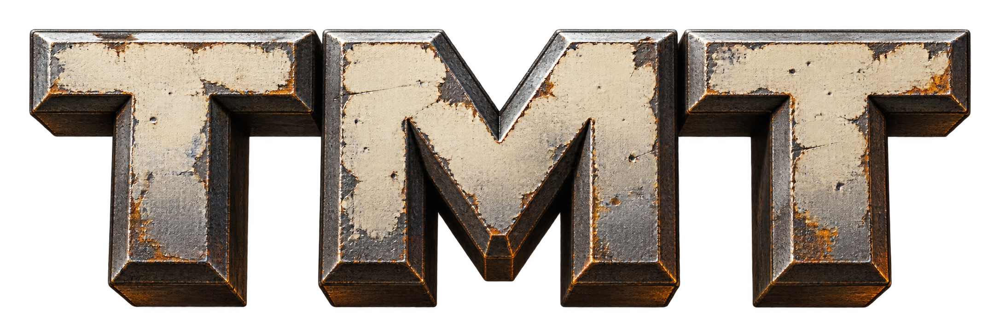
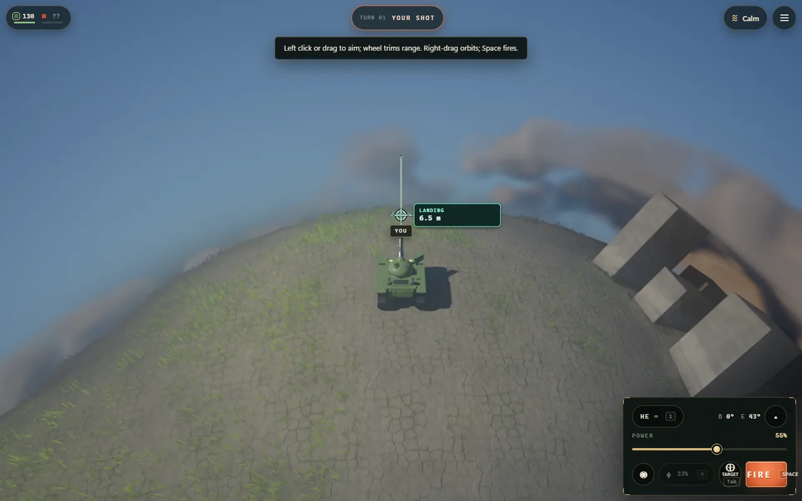
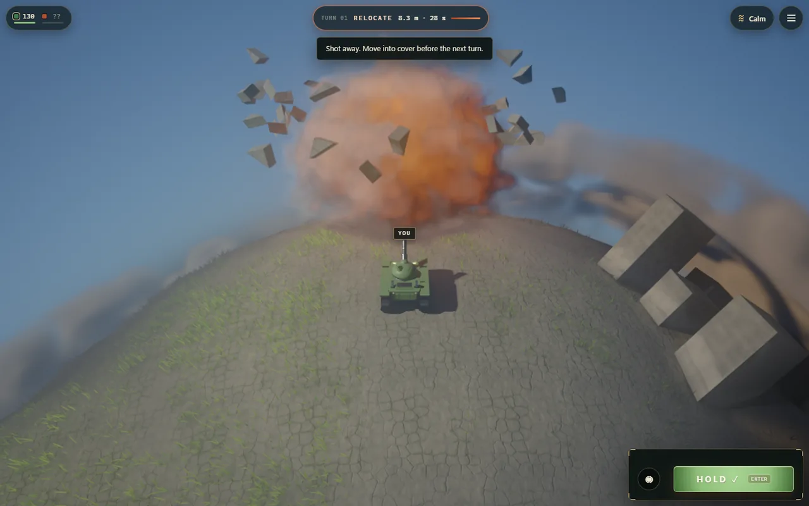
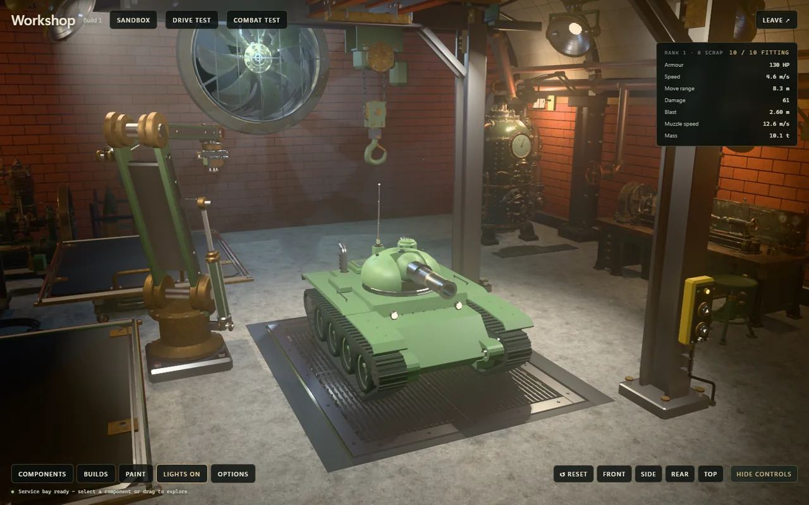
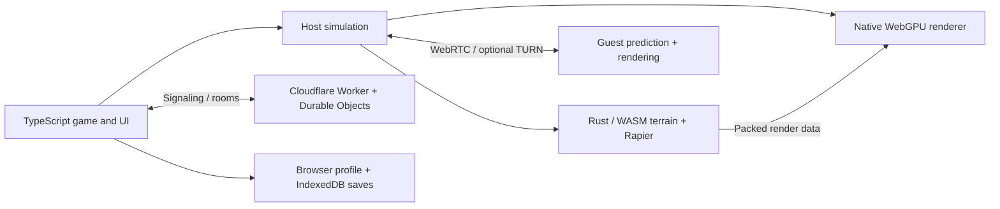

<p align="center"></p>

# Tiny Metal Tank

**Small tanks. Destructible planets. A whole little world to explore.**

Build and paint your tank, land on a procedural planet, and reshape the battlefield with every shot. Play the solo campaign, challenge the AI, or bring friends into multiplayer battles and co-op missions—all in your browser.

<h2 align="center"><a href="https://tmt.3merillon.workers.dev">🎮 Play the live demo →</a></h2>

<p align="center">No installation needed. Open in a recent Chrome or Edge browser with WebGPU support.</p>

<p align="center">
  <a href="https://3merillon.com">🌐 Made by 3merillon</a>
  &nbsp;&nbsp; · &nbsp;&nbsp;
  <a href="https://x.com/3merillon">𝕏 Follow updates</a>
  &nbsp;&nbsp; · &nbsp;&nbsp;
  <a href="https://buy.stripe.com/3cIcN77Lg7xv2g68sQdnW00">💛 Support development</a>
</p>



The game also serves as a foundation for your own experiments: explore its WebGPU renderer, Rust/WASM terrain and physics, procedural worlds, and multiplayer systems. First-party source is **MIT licensed**; dependency notices and media terms are separate. Start with the [architecture and source map](docs/architecture.md).

## A whole little world

- **Break the battlefield.** Blast craters through different materials, detach structures, and destroy moving debris. Terrain retains sharp intersections and material boundaries within its sampled geometry.
- **Make the tank yours.** Combine hulls, turrets, weapons, tracks, armor, and equipment in a mechanical workshop. Paint directly onto the metal with no stroke-count limit. Save your designs and share them automatically with online opponents.
- **Choose your battle.** Play solo missions, turn-based duels, realtime combat, or co-op. Same-screen play, touch controls, radar, fog of war, and procedural music and sound round out the game.
- **Fight in a living landscape.** Water, smoke, fire, and spray react to terrain and planetary gravity beneath volumetric clouds. These are effects designed for realtime gameplay.
- **Explore the engine.** A custom WebGPU renderer provides PBR lighting, soft shadows, temporal upscaling, and atmosphere. Higher quality tiers add diffuse global illumination. Rust/WASM and Rapier handle resident terrain and structural physics; TypeScript coordinates the game, rendering, and UI.

The renderer is modular, while planet, vehicle, terrain, and campaign systems retain game-specific assumptions. This is a working game foundation, not a packaged engine SDK; the architecture guide explains its boundaries and precision limits.

| Destruction in motion | Build your tank |
| --- | --- |
|  |  |

## Play together

| Mode | Players | How it plays |
| --- | --- | --- |
| Classic artillery | Local AI, same-screen, or 2–3 online | Aim, fire, and relocate in turns |
| Realtime artillery | Local AI or 2–3 online | Move, aim, and fire ballistic weapons simultaneously |
| Realtime PvP | 2–3 online | Simultaneous combat with automatic coaxial fire |
| Campaign co-op | Owner + up to 2 helpers | Start alone, join during a mission, and advance together |

Local **Artillery Duel** offers turn-based or realtime AI battles with 2–4 tanks, including 2v2 teams. Realtime uses the Rusty, Tosser, and Vex AI profiles; pass-and-play always takes turns.

Online Play includes quick matching, public rooms, passworded invitations, persistent parties, and chat. A player hosts the authoritative simulation; guests predict movement, reconcile snapshots, and interpolate other actors. Cloudflare coordinates rooms and signaling; WebRTC carries gameplay directly or through TURN.

Direct WebRTC connections can reveal your public IP address to other players in the room. Open the game with `?relay=1` to require TURN relay connections instead.

A missing 1v1 opponent pauses play for a three-minute reconnect window; expiry or explicit leaving ends the match. Three-player versus can continue with two, and co-op can continue after helpers leave. Recovery can pause and roll back to an acknowledged checkpoint. The host is trusted: this is casual peer-hosted multiplayer, not a server-side anti-cheat boundary.

**Campaign ownership stays with the owner even when simulation hosting changes.** Only the owner's stars/unlocks advance. Helpers receive separately recorded assistance XP/scrap for new or improved results. Profiles and saves stay in the browser; there is no account-based cloud-save service. [Multiplayer and recovery details](server/README.md).

## Run locally

Use **Node.js 22.12+** and a recent Chromium/Edge browser with working WebGPU. Serve over localhost or HTTPS; the game has no WebGL rendering fallback. GPU limits and drivers matter, and physical mobile/browser coverage remains a release qualification task.

```sh
npm ci
npm run dev
```

The title opens at the Vite address. Required WASM binaries are checked in; playing and building do not require Rust. For local multiplayer with Cloudflare's local runtime:

```sh
npm run dev:online
```

Open `http://localhost:8787`. Local direct connections need no Cloudflare account or TURN keys. Internet play needs an HTTPS deployment and TURN configuration for networks that cannot connect directly. For hot reload, run `npm run dev:hub` alongside `npm run dev` after a build.

```sh
npm run check             # TypeScript
npm run verify:fast       # Focused unit/integration projects
npm run verify:guard      # Architecture and determinism rules
npm run verify:bundle     # Production chunk and import budgets
npm run verify:repo       # Release-file, media, and documentation checks
npm run build            # Production output in dist/
```

[Development guide](docs/development.md) covers full tests, Rust builds, and browser captures. [Deployment guide](server/README.md) covers Worker/Durable Object setup and TURN secrets. `npm run deploy:check` prepares a Wrangler dry run; **`npm run deploy` publishes to your configured Cloudflare account**.

## How it fits together



| Technology | Its role here |
| --- | --- |
| TypeScript + Vite | Application, gameplay coordination, UI, development server, bundling |
| WebGPU + WGSL | Project-owned renderer, compute effects, lighting, shadows, post-processing |
| Rust + WebAssembly | Resident terrain/structural core and selected realtime simulation work |
| Rapier3D | Rigid-body solver inside the Rust core and the compatibility path |
| Cloudflare Workers + SQLite Durable Objects | Static hosting, directory, matchmaking, membership, signaling, authority coordination |
| WebRTC + TURN | Peer gameplay transport and relay fallback |

## Explore the code

| Path | Start here for… |
| --- | --- |
| [`src/engine/`](src/engine/README.md) | Render modules, frame graph, GPU resources, lighting, effects |
| [`src/gpu/terrain/`](src/gpu/terrain/) + [`rust/terrain-core/`](rust/terrain-core/) | Resident terrain, WASM interfaces, extraction, structural physics |
| [`src/core/`](src/core/) | Exact reference geometry kernel and audits |
| [`src/game/`](src/game/) | Lifecycle, rules, campaign, vehicles, UI, online coordination |
| [`src/world/`](src/world/) + [`src/audio/`](src/audio/) | Procedural worlds and audio |
| [`server/`](server/README.md) | Cloudflare multiplayer and local verification |
| [`tests/`](tests/) + [`scripts/`](scripts/) | Regressions, captures, builds, asset tooling |
| [`dev/`](dev/README.md) | Local renderer, kit, and structural diagnostics |
| [`docs/`](docs/README.md) | Guides, technical contracts, and qualification evidence |

Contributing? Read [CONTRIBUTING.md](CONTRIBUTING.md). Coding agents can start with [AGENTS.md](AGENTS.md) and follow the same checks. The [release report](docs/release-readiness.md) records measured sizes, completed checks, and remaining qualification limits.

## Credits and licensing

Thank you to **Rapier/Dimforge**, **Rust**, **WebAssembly**, **Vite**, **TypeScript**, **Vitest**, **Playwright**, **Cloudflare's development tools**, **meshoptimizer**, **sharp**, and **Three.js**. Their freely available work makes projects like this possible. Temporal upscaling includes adaptations credited to **pmndrs/upscaler** and **AMD FidelityFX**. Campaign voice generation uses the separately credited **Kokoro, HeadTTS, and Misaki** pipeline.

First-party source and documentation: [MIT](LICENSE). Preserve the [third-party notices](THIRD_PARTY.md) and [bundled licenses](public/THIRD-PARTY-NOTICES.txt) when redistributing. [Media provenance](docs/media.md) distinguishes procedural audio, generated workshop assets, branding, sources, and runtime packages; media is not automatically relicensed by the code license. Screenshots are captures of the actual game; [capture details](docs/images/README.md).
