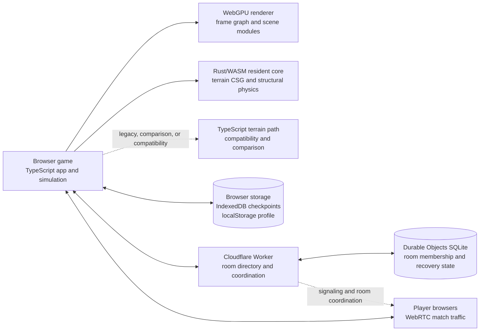

# Runtime architecture

TMT runs as a browser game. TypeScript owns the application, rendering orchestration, and most game-facing systems. Rust compiled to WebAssembly owns the default resident terrain and structural-physics path. Multiplayer room coordination and durable online room state run in a Cloudflare Worker with SQLite-backed Durable Objects; match simulation travels between peers. These pieces have separate ownership and persistence boundaries.

## Terrain and simulation

Terrain is represented by implicit fields sampled over a conforming tetrahedral grid. The arrangement kernel treats each primitive's interpolated field separately, clips the resulting planes into regions, applies the Boolean expression to the region signs, and labels the occupied regions with materials. It preserves sharp intersections and material interfaces in this piecewise-linear representation, including labeled solid-to-solid interfaces. This does not certify that the sampled surface has the same topology or exact shape as an arbitrary analytic field. The [algorithm contract](./algorithm.md) documents the numeric model and its limits.

In modern local play, [`ResidentGameTerrain.create`](../src/game/resident-terrain.ts) selects the Rust WASM resident engine by default. [`RustResidentTerrain`](../src/gpu/terrain/rust-service.ts) coordinates edits and publication; [`RustTerrainCore`](../src/gpu/terrain/rust-core.ts) calls the compiled core in [`rust/terrain-core`](../rust/terrain-core/src/lib.rs). The resident path owns terrain geometry, connectivity, body ownership, clipping, collider descriptions, and BVHs. The latest v22 engine supports material-selective crater shells. Earlier engine versions and the `terrainCore` query override exist for compatibility and comparison.

The TypeScript [`ResidentTerrain`](../src/gpu/terrain/service.ts) and worker/compiler path remain available for compatibility, comparison, and recovery. The renderer and browser application remain TypeScript. The separate [`realtime-core.wasm`](../src/game/realtime/core.ts) supplies selected deterministic realtime simulation work; it does not move the whole game into Rust.

Structural rigid bodies use Rapier3D. In the default resident Rust engine, the Rust core hosts Rapier and shares its WASM instance with terrain operations. The TypeScript compatibility adapter in [`structural-physics.ts`](../src/game/structural-physics.ts) uses the Rapier JavaScript package. This is a rigid-body system connected to generated terrain colliders; it is not a complete material-volume or deformable-body model.

Terrain edits prepare before committing a new published state. Validation failures, cancellation, or stale work must preserve the last committed world; moving-body queries retain their held poses until their query fences are released. Checkpoints record the engine version so supported older saves replay through the matching path. Some [`RustTerrainCore`](../src/gpu/terrain/rust-core.ts) outputs are explicitly marked ephemeral WASM views: consume or copy them before another allocating core call, which may grow memory or replace the output buffer.

## Rendering

Rust owns the resident terrain's render-publication data, including changed pages and packed surface/vertex recipes. The TypeScript render host consumes those packets; it does not reconstruct the terrain to discover what changed. GPU resource creation, frame-graph execution, render-pass encoding, and queue submission remain TypeScript/WebGPU. There is no native Rust `wgpu` renderer in this checkout. See [`publication.rs`](../rust/terrain-core/src/publication.rs), [`rust-service.ts`](../src/gpu/terrain/rust-service.ts), and [`Engine.frame`](../src/engine/engine.ts).

[`Engine`](../src/engine/engine.ts) is a modular WebGPU renderer with a frame graph, a G-buffer, deferred lighting, and installable render modules. The game composes core renderer systems with [`RENDER_MODULES`](../src/engine/modules.ts) and TMT scene modules from [`createSceneModules`](../src/engine/scene/index.ts). Mesh, light, camera, and module contracts can support other scenes, while planet fields, terrain presentation, weather, fluids, and game rules are TMT-specific. Treat it as a reusable renderer foundation, not a drop-in general-purpose engine.

The production game has no Three.js package dependency. Camera, transform, and triangle queries use local scalar math; adaptations of Three.js r180 retain its [MIT attribution](../THIRD_PARTY.md#adapted-threejs-math). Three.js remains a development dependency for diagnostic renderers under `src/lab/` and test oracles. Source import guards and the complete production bundle closure enforce that boundary, including lazy imports.

The exterior renderer combines map-based sun shadows and screen-space contact shadows with soft SDF visibility for the world and dynamic caster bricks. Diffuse GI uses SDF-traced probes, updated over time. Probe updates are disabled on Low and Medium quality tiers; High updates 2,048 probes per frame and Ultra 4,096. Interior rooms use authored low-energy indirect light instead of traced probe GI. The implementation is in [`sdf-volume.ts`](../src/engine/passes/sdf/sdf-volume.ts), [`sdf-casters.ts`](../src/engine/passes/sdf/sdf-casters.ts), [`lighting.wgsl.ts`](../src/engine/passes/lighting/lighting.wgsl.ts), and [`gi-probes.ts`](../src/engine/passes/gi/gi-probes.ts).

The exterior fluid module runs GPU passes for water, spray, gas, and liquid compositing. It is tailored to TMT's game effects and surface liquids, not a general-purpose computational fluid dynamics solver. CPU basin logic also lives in [`src/world/basins.ts`](../src/world/basins.ts). Volumetric clouds and their shadows are renderer modules with quality controls; the world weather module currently supplies deterministic wind and does not make clouds or rain part of the world simulation. See [`fluids.ts`](../src/engine/passes/fluids/fluids.ts), [`clouds.ts`](../src/engine/passes/clouds/clouds.ts), and [`weather.ts`](../src/world/weather.ts).

## Network and persistence

Online matches use browser-to-browser WebRTC for gameplay traffic. The Worker coordinates room discovery, admission, signaling, chat, and recovery. The elected player host runs the authoritative simulation and is trusted; hosting can move between players without transferring campaign ownership. The Worker does not run the simulation. See [`server/README.md`](../server/README.md) for deployment and operating boundaries.

Campaign checkpoints are saved in the browser's IndexedDB by [`campaign-save.ts`](../src/game/meta/campaign-save.ts); player profiles and preferences use browser localStorage in [`profile.ts`](../src/game/meta/profile.ts). These are local to the browser origin. Online room membership and recovery data are stored in SQLite-backed Durable Objects. The room database does not sync a player's campaign profile or provide account-based cloud saves.

Custom tank paint is persistent cosmetic data. The workshop rasterizes brush gestures into compressed RGBA tiles attached to component geometry at three LODs; presentation packs those tiles into mesh atlases. Gameplay samples the saved paint texture before applying temporary damage marks. Stroke count does not increase fragment-shader work, although texture area, storage capacity, atlas uploads while editing, and online byte limits still matter. The [workshop contract](../src/game/workshop/README.md#paint-and-lighting) records resolution, migration, undo, and save behavior.

[`OnlineAppearanceSync`](../src/game/online/appearance.ts) exchanges SHA-256-addressed, deflate-compressed cosmetics through the existing peer links. Appearance transfers have lower priority than gameplay, snapshots, and recovery; they are absent from authoritative checkpoints and never grant equipment or progression. Each received design is validated and cached, then associated with its authenticated seat. A default appearance renders until the asset arrives. See [appearance transfer limits](../server/README.md#custom-paint-transfer).

## Contracts and invariants

The versioned TypeScript contracts live with their owners: [`engine/contracts.ts`](../src/engine/contracts.ts) defines renderer services, [`game/contracts.ts`](../src/game/contracts.ts) and [`game/api/`](../src/game/api/) define game/session boundaries, and [`gpu/terrain/`](../src/gpu/terrain/) defines terrain transactions and publication. Extend those owners rather than introducing competing renderers, simulations, or save systems.

- `src/engine` does not import `src/game`. `src/world` has no engine, game, or DOM dependencies.
- Simulation advances through explicit ticks and seeded random state. Rendering, audio, wall-clock timing, and ambient randomness stay outside deterministic paths.
- Rust owns native resident geometry, connectivity, publication, and structural physics. TypeScript compatibility paths remain necessary for supported saves and comparison tests.
- Public interfaces, save formats, worker/network packets, WASM ABIs, and shader bindings require compatible changes or an explicit migration.
- Simulation hosting and campaign ownership remain separate. Reconnect grace, authority leases, checkpoints, late joining, and owner/helper rewards are part of the online contract.

`npm run verify:guard` enforces import and determinism rules; subsystem tests cover the remaining contracts. [Development](development.md#validation) describes the required checks and their limits.

## Source map

| Area | Current entry points |
|---|---|
| Engine lifecycle and core render systems | [`engine.ts`](../src/engine/engine.ts), [`contracts.ts`](../src/engine/contracts.ts) |
| Optional renderer modules and game scene composition | [`modules.ts`](../src/engine/modules.ts), [`scene/index.ts`](../src/engine/scene/index.ts) |
| Resident terrain and worker compiler | [`resident-terrain.ts`](../src/game/resident-terrain.ts), [`rust-service.ts`](../src/gpu/terrain/rust-service.ts), [`service.ts`](../src/gpu/terrain/service.ts) |
| Rust terrain and physics implementation | [`rust/terrain-core`](../rust/terrain-core/src/lib.rs), [`physics.rs`](../rust/terrain-core/src/physics.rs) |
| Realtime WASM core | [`core.ts`](../src/game/realtime/core.ts), [`rust/realtime-core`](../rust/realtime-core/src/lib.rs) |
| Local and online storage | [`campaign-save.ts`](../src/game/meta/campaign-save.ts), [`server/README.md`](../server/README.md) |
